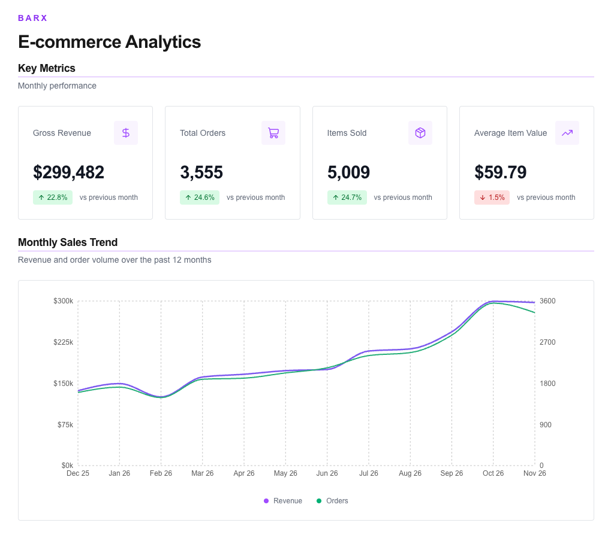
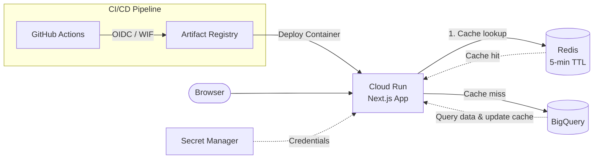

# Barx E-Commerce Analytics

Project showcasing GCP architecture, containerized deployment, and automated CI/CD, built after earning the Google Cloud ACE certification.

## Demo



## Architecture



## Infrastructure

**Container**

- Docker multi-stage build with Next.js standalone output
- Linux AMD64 image

**Hosting**

- Artifact Registry and Cloud Run (`us-west4`)
- Autoscaling: 0–2 instances
- Resources: 1 vCPU, 512 MiB memory

**Data**

- BigQuery for analytics data
- Redis for API response caching (5-minute TTL)
- Secret Manager for Redis credentials

**CI/CD**

- GitHub Actions with OIDC-based Workload Identity Federation

## Local Development

```bash
npm install
npm run dev
```
