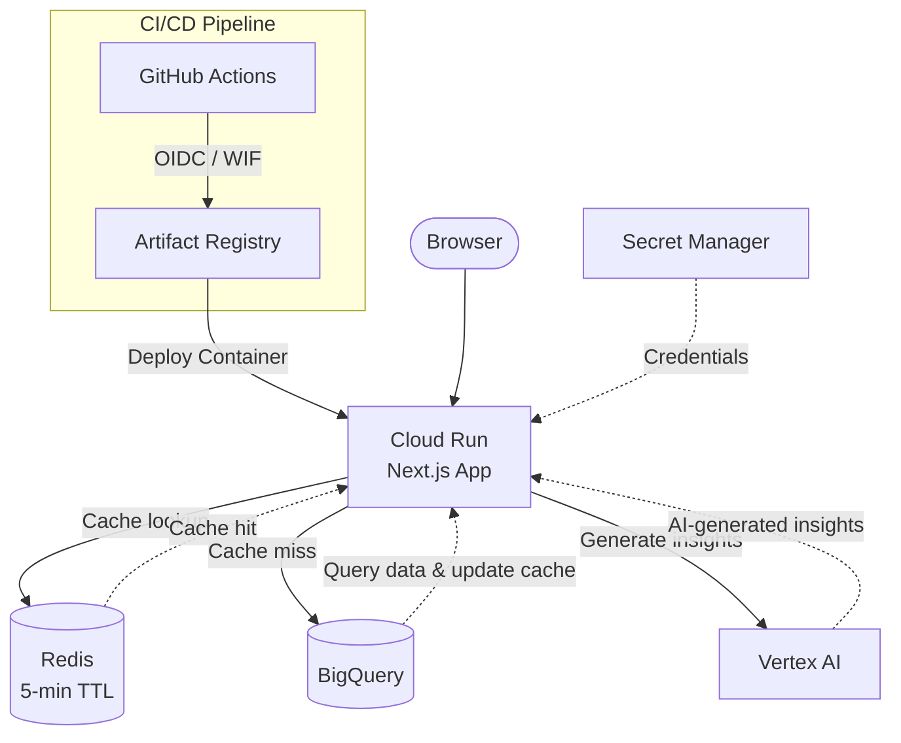

# Barx E-Commerce Analytics

A simple Next.js and BigQuery dashboard demonstrating a scalable GCP architecture: containerized on Cloud Run, deployed through automated CI/CD, with Vertex AI-powered insights.

## Demo

[https://barx-lbxqsqz6ga-wn.a.run.app/](https://barx-lbxqsqz6ga-wn.a.run.app/)


## Architecture



## Infrastructure

**Container**

- Docker multi-stage build with Next.js standalone output
- Linux AMD64 image

**Hosting**

- Artifact Registry and Cloud Run
- Autoscaling: 0–2 instances
- Resources: 1 vCPU, 512 MiB memory

**Data**

- BigQuery for analytics data
- Redis for API response caching
- Secret Manager for Redis credentials

**AI**

- Vertex AI (Gemini) for AI-generated business insights
- Google Cloud IAM authentication using the Cloud Run runtime service account

**CI/CD**

- GitHub Actions with OIDC-based Workload Identity Federation

## Local Development

**Prerequisites:** Node.js, Google Cloud CLI, access to the GCP project, and an Upstash Redis database.

Authenticate with Google Cloud:

```bash
gcloud auth application-default login
gcloud config set project YOUR_PROJECT_ID
```

Configure `.env.local`:

```env
GCP_PROJECT_ID=your-project-id
UPSTASH_REDIS_REST_URL=your-redis-url
UPSTASH_REDIS_REST_TOKEN=your-redis-token
```

Run locally:

```bash
npm install
npm run dev
```

## Author

Jorge Donoso
